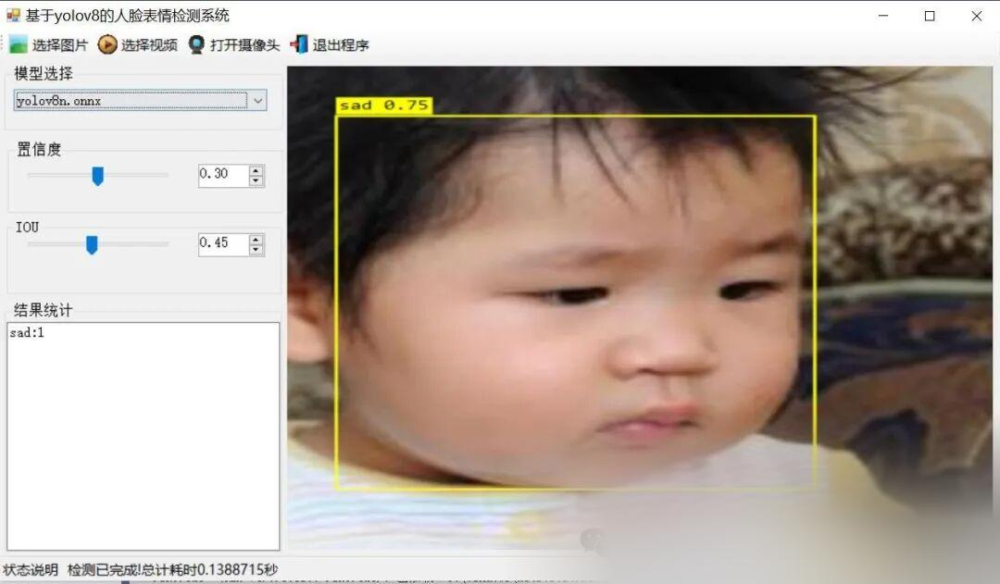
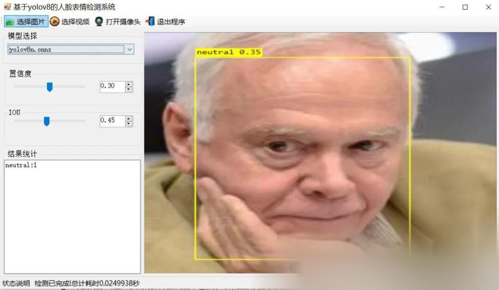

# C# Winform 8-Face Expression Detection System Based on YOLOv8

[Important Notice]

This system employs OpenCVSharp for image processing and ONNX Runtime as the inference engine, utilizing CPU for inference. It is suitable for both Windows X64 systems with or without a graphics card, and does not support macOS and Linux systems. It does not support x86 Windows operating systems. Since it uses CPU inference, it is slower than GPU-based inference. To accommodate most operating systems, we have temporarily only written the CPU inference source code. The GPU inference source code may be adjusted later based on needs. Currently, we are primarily considering CPU inference, mainly to accommodate students who do not have a graphics card and many of whom are using this source code.

[Algorithm Introduction]

A face emotion detection system based on YOLOv8 is a project that integrates advanced object detection algorithms (YOLOv8) with deep learning techniques, aiming to recognize and classify human facial expressions in real-time or offline (such as happiness, sadness, anger, surprise, fear, disgust, neutral, etc.). The following is a brief introduction outlining the core points of the system's Python source code:

The system directly utilizes the YOLOv8 model for facial expression recognition. YOLOv8 is known for its high efficiency and accuracy, making it highly suitable for real-time applications.

The implementation of Python source code typically includes the following key parts:

1.

Environment Configuration: Install necessary libraries, such as onnxruntime (for YOLOv8 model inference), OpenCV (for image processing) etc.

1.

Model Loading: Load the pre-trained YOLOv8 face expression recognition model.

1.

Image/Video Processing: Read in input images or videos, perform preprocessing (such as resizing, normalization).

1.

Face Detection and Emotion Recognition: Use YOLOv8 to directly output the results of face emotion detection.

1.

Results: Label detected faces and expressions on images or video frames, and display the results.

Such systems can be widely applied in fields such as human-computer interaction, emotional analysis, and security monitoring.

[Effect Demonstration]





[Test Environment]

Windows 10 x64 system
Visual Studio 2019
.NET Framework 4.7.2
OpenCVSharp 4.8.0
ONNX Runtime 1.16.3

The model can detect the category.

anger
content
disgust
fear
happy
neutral
sad
surprise

[Related Reference Training Data Set]

https://blog.csdn.net/FL1623863129/article/details/128648951

[Training Information]

| Parameter | Value |
| ----------- | -------- |
| Training set images count | 6586 |
| Validation set images count | 1873 |
| Training map | 76.6% |
| Training precision (Precision) | 64.1% |
| Training recall (Recall) | 75.4% |

[Partial Implementation Source Code]

-
-
-
-
-
-
-
-
-
-
-
-
-
-
-
-
-
-
-
-
-
-
-
-
-
-
-
-
-
-
-
-
-
-
-
-
-
-
-
-
-
-
-
-
-
-
-
-
-
-
-
-
-
-
-
-
-
-
-
-
-
-
-
-
-
-
-
-
-
-
-
-
-
-
-
-
-
-
-
-
-
-
-
-
-
-
-
-
-
-
-
-
-
-
-
-
-
-
-
-
-
-
-
-
-
-
-
-
-
-
-
-
-
-
-
-
-
-
-
-
-
-
-
-
-
-
-
-
-
-
-
-
-
-
-
-
-
-
-
-
-
-
-
-
-
-
-
-
-
-
-
-
-
-
-
-
-
-
-
-
-
-
-
-
-
-
-
-
-
-
-
-
-
-
-
-
-
-
-
-
-
-
-
-
-
-
-
-
-
-
-
-
-
-
-
-
-
-
-
-
-
-
-
-
-
-
-
-
-
-
-
-
-
-
-
-
-
-
-
-
-
-
-
-
-
-
-
-
-
-
-
-
-
-
-
-
-
-
-
-
-
-
-
-
-
-
-
-
-
-
-
-
-
-
-
-
-
-
-
-
-
-
-
-

```
using OpenCvSharp;using System;using System.Collections.Generic;using System.ComponentModel;using System.Data;using System.Diagnostics;using System.Drawing;using System.IO;using System.Linq;using System.Text;using System.Threading;using System.Threading.Tasks;using System.Windows.Forms; namespace FIRC{    public partial class Form1 : Form    {         public bool videoStart = false;//Video stop sign        string weightsPath = Application.StartupPath + "\\weights";//Model Catalog        string labelTxt= Application.StartupPath + "\\weights\\class_names.txt";//Category file        Yolov8Manager detetor = new Yolov8Manager();//Inference engine        public Form1()        {            InitializeComponent();            CheckForIllegalCrossThreadCalls = false;//Thread updates control without error.        }        private void LoadWeightsFromDir()        {            var di = new DirectoryInfo(weightsPath);            foreach(var fi in di.GetFiles("*.onnx"))            {                comboBox1.Items.Add(fi.Name);            }            if(comboBox1.Items.Count>0)            {                comboBox1.SelectedIndex = 0;            }            else            {                tssl_show.Text = "Model not found,Please close the program and put the model intoweightsFolder!";                tsb_pic.Enabled = false;                tsb_video.Enabled = false;                tsb_camera.Enabled = false;            }        }        private void Form1_Load(object sender, EventArgs e)        {            LoadWeightsFromDir();//Load model from directory        }        public string GetResultString(Result result)        {            Dictionary<string, int> resultDict = new Dictionary<string, int>();            for (int i = 0; i < result.length; i++)            {                if(resultDict.ContainsKey( result.classes[i]) )                {                    resultDict[result.classes[i]]++;                }                else                {                    resultDict[result.classes[i]]=1;                }            }             var resultStr = "";            foreach(var item in resultDict)            {                resultStr += string.Format("{0}:{1}\n",item.Key,item.Value);            }            return resultStr;        }        private void tsb_pic_Click(object sender, EventArgs e)        {            OpenFileDialog ofd = new OpenFileDialog();            ofd.Filter = "*.*|*.bmp;*.jpg;*.jpeg;*.tiff;*.tiff;*.png";            if (ofd.ShowDialog() != DialogResult.OK) return;            tssl_show.Text = "Detecting......";            Task.Run(() => {                var sw = new Stopwatch();                sw.Start();                Mat image = Cv2.ImRead(ofd.FileName);                detetor.Confidence =Convert.ToSingle(numericUpDown1.Value);                detetor.IOU = Convert.ToSingle(numericUpDown2.Value);                var results=detetor.Inference(image);                                var resultImage = detetor.DrawImage(OpenCvSharp.Extensions.BitmapConverter.ToBitmap(image), results);                    sw.Stop();                pb_show.Image = resultImage;                tb_res.Text = GetResultString(results);                tssl_show.Text = "Test completed!Total time spent"+sw.Elapsed.TotalSeconds+"Second";            });                     }         public void VideoProcess(string videoPath)        {            Task.Run(() => {                 detetor.Confidence = Convert.ToSingle(numericUpDown1.Value);                detetor.IOU = Convert.ToSingle(numericUpDown2.Value);                VideoCapture capture = new VideoCapture(videoPath);                if (!capture.IsOpened())                {                    tssl_show.Text="Video failed to open!";                    return;                }                Mat frame = new Mat();                var sw = new Stopwatch();                int fps = 0;                while (videoStart)                {                     capture.Read(frame);                    if (frame.Empty())                    {                        Console.WriteLine("data is empty!");                        break;                    }                    sw.Start();                    var results = detetor.Inference(frame);                    var resultImg = detetor.DrawImage(frame,results);                    sw.Stop();                    fps = Convert.ToInt32(1 / sw.Elapsed.TotalSeconds);                    sw.Reset();                    Cv2.PutText(resultImg, "FPS=" + fps, new OpenCvSharp.Point(30, 30), HersheyFonts.HersheyComplex, 1.0, new Scalar(255, 0, 0), 3);                    //Display results                    pb_show.Image = OpenCvSharp.Extensions.BitmapConverter.ToBitmap(resultImg);                    tb_res.Text = GetResultString(results);                    Thread.Sleep(5);                  }                 capture.Release();                 pb_show.Image = null;                tssl_show.Text = "The video has stopped.!";                tsb_video.Text = "Select video";             });        }        public void CameraProcess(int cameraIndex=0)        {            Task.Run(() => {                 detetor.Confidence = Convert.ToSingle(numericUpDown1.Value);                detetor.IOU = Convert.ToSingle(numericUpDown2.Value);                VideoCapture capture = new VideoCapture(cameraIndex);                if (!capture.IsOpened())                {                    tssl_show.Text = "Camera failed to open!";                    return;                }                Mat frame = new Mat();                var sw = new Stopwatch();                int fps = 0;                while (videoStart)                {                     capture.Read(frame);                    if (frame.Empty())                    {                        Console.WriteLine("data is empty!");                        break;                    }                    sw.Start();                    var results = detetor.Inference(frame);                    var resultImg = detetor.DrawImage(frame, results);                    sw.Stop();                    fps = Convert.ToInt32(1 / sw.Elapsed.TotalSeconds);                    sw.Reset();                    Cv2.PutText(resultImg, "FPS=" + fps, new OpenCvSharp.Point(30, 30), HersheyFonts.HersheyComplex, 1.0, new Scalar(255, 0, 0), 3);                    //Display results                    pb_show.Image = OpenCvSharp.Extensions.BitmapConverter.ToBitmap(resultImg);                    tb_res.Text = GetResultString(results);                    Thread.Sleep(5);                  }                 capture.Release();                 pb_show.Image = null;                tssl_show.Text = "Camera has stopped!";                tsb_camera.Text = "Turn on the camera";             });        }        private void tsb_video_Click(object sender, EventArgs e)        {            if(tsb_video.Text=="Select video")            {                OpenFileDialog ofd = new OpenFileDialog();                ofd.Filter = "Video file(*.*)|*.mp4;*.avi";                if (ofd.ShowDialog() != DialogResult.OK) return;                videoStart = true;                VideoProcess(ofd.FileName);                tsb_video.Text = "Stop";                tssl_show.Text = "Video is being detected....";             }            else            {                videoStart = false;                           }        }         private void tsb_camera_Click(object sender, EventArgs e)        {            if (tsb_camera.Text == "Turn on the camera")            {                videoStart = true;                CameraProcess(0);                tsb_camera.Text = "Stop";                tssl_show.Text = "Camera is in detection mode....";             }            else            {                videoStart = false;             }        }         private void tsb_exit_Click(object sender, EventArgs e)        {            videoStart = false;            this.Close();        }         private void trackBar1_Scroll(object sender, EventArgs e)        {            numericUpDown1.Value = Convert.ToDecimal(trackBar1.Value / 100.0f);        }         private void trackBar2_Scroll(object sender, EventArgs e)        {            numericUpDown2.Value = Convert.ToDecimal(trackBar2.Value / 100.0f);        }         private void numericUpDown1_ValueChanged(object sender, EventArgs e)        {            trackBar1.Value = (int)(Convert.ToSingle(numericUpDown1.Value) * 100);        }         private void numericUpDown2_ValueChanged(object sender, EventArgs e)        {            trackBar2.Value = (int)(Convert.ToSingle(numericUpDown2.Value) * 100);        }         private void comboBox1_SelectedIndexChanged(object sender, EventArgs e)        {            tssl_show.Text="Load model:"+comboBox1.Text;            detetor.LoadWeights(weightsPath+"\\"+comboBox1.Text,labelTxt);            tssl_show.Text = "Model loading is complete.!";        }    }}
```

[Usage Steps]

Usage Steps:
1. First, install the YOLOv8 environment according to the official framework https://github.com/ultralytics/ultralytics and convert your own PT model into ONNX model using the official export command.
2. Open the Sln project in VS2019, select x64 release, and modify some necessary parameters such as input shape, etc. Click Run to view the final result.

Please note that if there are any runtime errors, refer to my blog for re-invoking the DLL of my source code: [C#] OpenCVSharp error System.Memory, Version=4.0.1.2, Culture=neutral, PublicKeyToken=cc7b13fcd2ddd51 "Version higher than the referenced_ failed to load file or assembly" "system.memory, version=4.0.1.2, culture-CSDN blog

[Provided Files]

C# Source Code
YOLOv8n.onnx Model (No PyTorch model provided)
Training Map, P, R Curve Plots (in weights\results.png)
Test Images (under test_img folder)

[Source code download link]

Follow WeChat Official Account [Future Autonomous Research Center] and reply with "firc7" to get the download method.


## Payment

Here is a pay link on Stripe ( https://buy.stripe.com/3cs8yP7sY87d0vu9AB ). Please contact me lonlonago@foxmail.com after funding $89, and I will send you a complete data files , thank you!


